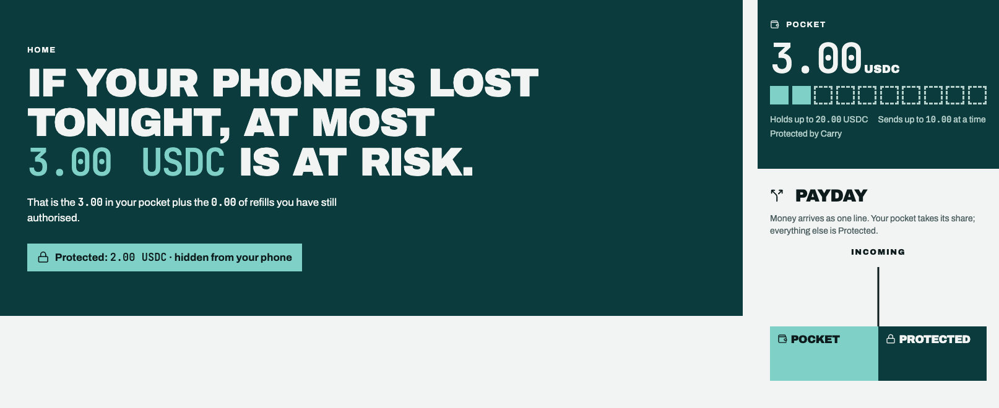
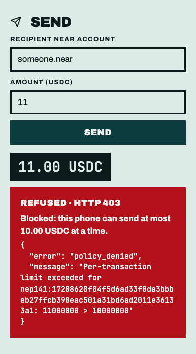
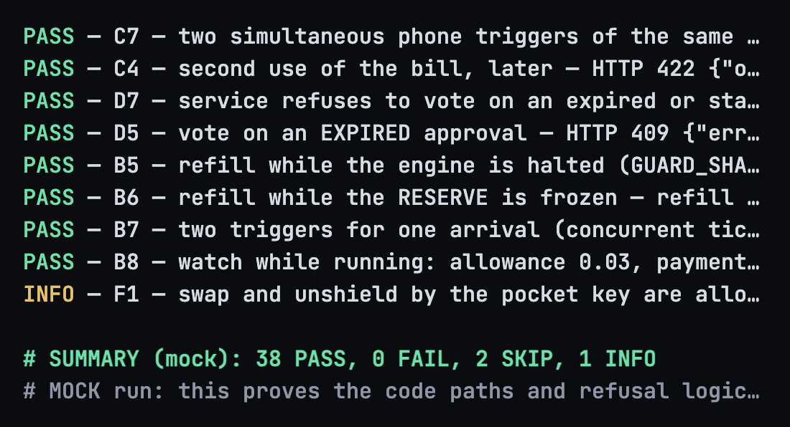

# Carry

Robbed, scammed or hacked? They only get what you carry.

Carry splits money the moment it arrives. You receive money through one link, from another chain (USDC on Solana, Base, Arbitrum or Ethereum, or USDT on Tron). A small, capped share goes to the pocket on your phone; the rest lands in a confidential NEAR reserve that the phone cannot see, reach or unlock. Whoever controls the phone (a robber, a scammer coaching you on a call, malware, a phishing approval) can take only what is in the pocket, plus refills you have already authorised from your laptop.

Built at NEAR HACKATHON, November 2026. Tracks: Privacy & Private AI, Real-World Money, AI Security & Defense.

- **Try it in your browser:** https://demo.carry.ajkadri.dev (a public sandbox: simulated money, your own private demo, nothing to install).
- **Try it locally in 2 minutes, no keys:** `npm install && npm run demo` (Node 22.13+, simulated money). Steps under "Run it".
- **Check the claims:** `npm run attack` replays 38 attacks from the phone's side; each prints its raw refusal.
- **Live instance (the owner's):** https://carry.ajkadri.dev runs on NEAR mainnet with the owner's keys. The pay page is public; Home needs the owner's laptop key. To try Carry yourself, use the sandbox above, not this.
- **Demo video:** _link added after recording_



## Why

- In Nigeria, police officers have searched people's phones and forced them to transfer money, including crypto, on the spot ([Gazette](https://gazettengr.com/?p=411360), [ICIR](https://www.icirnigeria.org/special-report-despite-endsars-protest-police-harassments-persist-use-pos-for-extortion/), [Guardian](https://guardian.ng/?p=2508484)).
- CertiK verified 72 physical "wrench attacks" on crypto holders in 2025, up 75% ([Decrypt](https://decrypt.co/356604)), and 52 in the first half of 2026 ([Decrypt](https://decrypt.co/374136)).
- Security guidance recommends time delays and multisig, and warns that decoy "duress" wallets are unreliable ([Decrypt](https://decrypt.co/321821/7-ways-protect-yourself-crypto-attacks), [Casa](https://blog.casa.io/can-duress-wallets-stop-bitcoin-attacks/)).
- Today's phone wallets keep the whole balance one unlock away.

## Prior work

| | What it does | Carry's difference |
|---|---|---|
| Bitkey | The phone spends up to a daily transfer limit without the hardware device; a transaction that puts you over the limit needs hardware approval ([Bitkey support](https://support.bitkey.world/hc/en-us/articles/18800065958420-What-happens-if-I-exceed-my-daily-transfer-limit)) | Cross-chain intake via NEAR Intents (USDC on Solana, Base, Arbitrum, Ethereum; USDT on Tron); balance is confidential; income is split on arrival |
| Safe (spending limits, Delay modifier) | A chosen address can spend a capped amount of a token from a Safe account without the usual signatures, enforced onchain by the allowance module ([Safe help](https://help.safe.global/en/articles/40842-set-up-and-use-spending-limits)); the Zodiac Delay modifier queues transactions behind a cooldown before they can run ([Zodiac Delay](https://github.com/gnosisguild/zodiac-modifier-delay)) | Balances stay public there; no automatic split of incoming money |
| Argent (guardians) | A transaction is started by the owner and approved by half the guardians, rounded up ([Argent support](https://support.argent.xyz/hc/en-us/articles/360008828238-Guardian-approvals-needed-in-Ethereum-account)) | Balances stay public there; no automatic split of incoming money |

The protective mechanics (caps, allow-lists, a separate vault) are not new. What is new here is the combination: a hidden balance, a phone that cannot raise its own limits, and protection that starts the moment money arrives, all checked by a re-runnable attack script.

## What exists today

- **Pay link and intake** ([`server/intake.js`](server/intake.js), [`server/chains.js`](server/chains.js), [`server/oneclick.js`](server/oneclick.js); page `/pay/:handle`): the payer picks a source (USDC on Solana, Base, Arbitrum or Ethereum, or USDT on Tron; offered only if 1Click's `/v0/tokens` lists it), enters an amount and their own address on that chain (checked per chain: Solana base58, EVM `0x…`, Tron base58check), and gets a 1Click deposit address. Whatever the source, it is delivered as USDC to the reserve's *confidential* balance with the 1Click partner key (no reserve key is involved). The page shows the fee and the lowest accepted amount from a dry quote for the chosen chain. Arrivals are tracked through 1Click `/v0/status` and logged as `payment_in` with the chain. **Tested live with a real payment: USDC on Solana and USDC on Base. Quote-tested only (live dry quotes, no money): Arbitrum, Ethereum, Tron.** Mock mode simulates all five.
- **Guard** ([`server/guard.js`](server/guard.js), `test/guard.test.js`, `test/voter.test.js`): a pure, unit-tested function that decides which pending OutLayer approvals Carry's approver may vote on. It approves only (a) a confidential USDC transfer to the pocket that keeps it under the phone ceiling (set in config, default 20 USDC) and within the remaining total-refill allowance (set by you from Home), and (b) the stored bill (exact payee, exact amount, unused, before expiry). It refuses to vote on an approval that has expired or is older than 5 minutes, because OutLayer's vote endpoint does not refuse late votes. Everything else gets no vote and a logged reason.
- **Refill engine** ([`server/engine.js`](server/engine.js), [`server/outlayer.js`](server/outlayer.js), `test/engine.test.js`, `test/tick-resilience.test.js`): one refill at a time, idempotent per arrival, state in SQLite. Each refill is requested, checked by the guard, reserved against the allowance, voted on and confirmed, with every step logged. A refill moves min(refill allowance, reserve balance, ceiling headroom), independent of the payment amount after fees. Reads retry on temporary 5xx errors and timeouts and log a soft `tick_warning`; idle ticks make no platform reads.
- **Home controls** ([`server/homeauth.js`](server/homeauth.js), [`web/src/homeKey.js`](web/src/homeKey.js), `test/routes.test.js`): the laptop's browser makes a non-extractable ECDSA P-256 key (WebCrypto, kept in IndexedDB); the server stores only the public key, after a one-time console code. Every request under `/api/home/*` (bills, refill allowance, halt, exit request, pairing, reserve balance, full log) carries a signature over method, path, body hash, timestamp and a one-use nonce. A wrong signature, a timestamp more than 60 s off, a replayed nonce or a tampered body gets a bare 401 and is logged as `home_blocked`. The check runs before the route table, so nothing unsigned reaches a home route, and the phone API has no route that creates a bill, changes an amount, raises the allowance or reads the reserve.
- **Phone pairing** ([`server/pairing.js`](server/pairing.js), `test/pairing-link.test.js`): the laptop shows a QR and a confirmation code; the phone claims it and shows the same code; only after the laptop user confirms does the phone receive its pocket credential, once, and nothing else. The "pairing link" under the QR is the same address as the QR (same session, same one-time secret, same 5-minute expiry); it is shown only on Home and can be claimed once. The secret travels in the URL fragment and an `X-Pair-Secret` header, never in a query string or a log.
- **Phone view and privacy** ([`web/src/phone.jsx`](web/src/phone.jsx), `test/phone-privacy.test.js`): the phone API reads the pocket balance and the bill list, never the reserve, and the phone never shows a reserve amount, in text, in the DOM or in any API response the phone view loads; the Protected band carries only its label. The test fails if any of that changes.
- **Web app** (`web/src/`, [`web/src/tokens.css`](web/src/tokens.css)): every colour, font, size and motion value lives in `tokens.css`, and a test fails if a literal colour appears anywhere else. Home opens with a plain-words summary ("If your phone is lost tonight, at most X USDC is at risk", X = pocket plus refills still authorised) and the Protected amount, both Home-only; the activity log has Money and System tabs, folds repeated blocked requests and keeps the raw JSON behind "raw".
- **Public sandbox** ([`server/sandbox.js`](server/sandbox.js), [`server/sandbox-main.js`](server/sandbox-main.js), `test/sandbox.test.js`): the same app in mock mode, but every visitor gets their own in-memory world (store, mock OutLayer and 1Click, home key, pairing) behind a random HttpOnly session cookie, so two browsers never see each other's balances, logs or pairing. Home sets itself up (the browser still makes its own non-extractable device key) and opens with a four-step guided tour (simulate a client payment, open the phone view, try to send 500, pay the rent from the phone), each step ticked by the session's real events; "Open the phone view" pairs a phone tab to the same demo, "Reset my demo" starts a fresh world, and a banner on every page says the money is simulated. Up to 500 worlds (least recently used dropped first), 2 hours idle expiry, 30 new worlds per IP per hour. It refuses to start unless `CARRY_MODE=mock` and no live key is in its environment, and it runs as a separate service from the live one. `npm run test:sandbox` runs the whole unit suite through the sandbox's session code path and `npm run attack:sandbox` runs the attack script through it.
- **Attack script and mock mode** ([`scripts/attack.js`](scripts/attack.js), [`server/mock.js`](server/mock.js), `evidence/`): `npm run attack` replays 30+ attack cases (the phone exceeding caps, creating or editing a bill, raising the allowance; a leaked reserve key; an altered bill amount or payee; second and simultaneous bill use; wrong-key, replayed, second and expired votes; refills above the allowance or ceiling, while halted or frozen; two triggers for one arrival), one PASS/FAIL line each with the raw refusal, and shows each refused request still pending with balances unchanged. Mock mode (the default, no keys) is an in-memory stand-in for OutLayer and 1Click that speaks the same request shapes and verifies vote signatures; it proves the code paths, not mainnet.
- **Storage and stack**: an SQLite activity log (`node:sqlite`, Node 22.13+, [`server/db.js`](server/db.js)) and a React (Vite) web app.

## What you'll see

<table>
<tr>
<td width="50%" valign="top"><br><sub>The phone tries to send 11.00 and is refused, with the raw reason shown.</sub></td>
<td width="50%" valign="top"><br><sub>The end of <code>npm run attack</code> (mock): 38 PASS, 0 FAIL, 2 SKIP, 1 INFO.</sub></td>
</tr>
</table>

## Run it

Needs Node 22.13 or newer. No keys, no network: `npm run demo` forces mock mode and a throwaway database (`data/demo.db`).

```bash
npm install
npm run demo
```

The terminal prints a one-time setup code. Then:

1. **Home.** Open http://127.0.0.1:8787/home, type the setup code and press "Set up". Home opens on a summary: "If your phone is lost tonight, at most 3.00 USDC is at risk" (a 0.00 pocket plus the 3.00 of refills the demo has authorised) and "Protected: 0.00 USDC · hidden from your phone". Below it are the three-step "How Carry protects you" strip, a "No payments yet" note and, further down, "Refills left: 3.00 USDC". Mock mode starts with a demo refill allowance of 3 USDC (set `CARRY_DEMO_ALLOWANCE_USDC` to change it; live mode always starts at 0).
2. **First payment.** In a second tab open http://127.0.0.1:8787/pay/demo. The amount is already 5. Leave "Pay with" on USDC on Solana (the list also offers Base, Arbitrum, Ethereum and Tron; each needs an address in its own format). Type any Solana address (for example `7puyGCiSnh55z3EzWEr8MKDBw9FYH2izq4K4mXPNpcuo`), press "Get payment address", then press "Mock: simulate this payment". The page changes to "Payment received".
3. **Payday split.** Back on Home, after a few seconds the Payday panel shows one incoming line of 5.00 forking into **Pocket +3.00** and **Protected +2.00**. The summary now reads "at most 3.00 USDC" (the pocket; no refills left) and "Protected: 2.00 USDC". The Pocket room shows 3.00 / 20.00. Press "Replay" to watch the split again. The Activity list at the bottom says "Payment received 5.00" and "Moved 3.00 to your pocket" in plain words, with the raw record behind "raw".
4. **Pair the phone view.** The phone is paired from Home. On Home press "Pair phone": a QR code appears with a "pairing link" under it. With a real phone you scan the QR (see below). On the same machine, right-click "pairing link", copy the link address, and open it in a **private window** (or a second browser): that window is "the phone". It shows a 6-digit code; Home shows the same code. Press "Yes, same code: pair it" on Home. The private window says "Paired" and offers "Open the pocket".
5. **Phone view.** In that window open http://127.0.0.1:8787/phone. It shows Pocket 3.00 USDC, "Holds up to 20.00 USDC", "Sends up to 10.00 at a time", the same Payday split with the band labelled only "Protected" (never an amount), a Send form and the bills. Type any recipient (`someone.near`), amount 11, press "Send": a red slab says "Blocked: this phone can send at most 10.00 USDC at a time." with the raw refusal below it.
6. **Rent (optional).** On Home, "Pre-approved bill": Id `rent`, Payee `d7041ab1063b3f017ae4d43857b225c2897b0d39682cbd2048c539a04b4805a4` (the mock landlord, which is on the mock reserve's whitelist), Amount 15, Expires `2030-01-01T00:00:00Z`, press "Save bill". Make a second payment of 20 on the pay page (step 2) so the reserve holds at least 15, then on the phone view press "Pay" on the Rent tile: it flips to "Paid".

Other pages: the pay link is http://127.0.0.1:8787/pay/demo and the activity log is at the bottom of Home.

**Using a real phone.** Home must be opened on the laptop at `http://127.0.0.1:8787/home`. To let a phone reach the pairing page, bind to the network and tell Carry its public address, and do the first setup before anyone else can reach the server:

```bash
HOST=0.0.0.0 CARRY_PUBLIC_URL=http://192.168.1.20:8787 npm run demo
```

Replace `192.168.1.20` with the laptop's address on your Wi-Fi. `CARRY_PUBLIC_URL` is the base address put in the QR code. The phone and the laptop must be on the same network. Home routes still need the laptop's signature, but anyone on that network can reach the pay and phone pages, so use it for a demo only.

```bash
npm test          # unit tests
npm run attack    # the attack replay in mock mode
```

## Who runs Carry

**Who runs Carry today.** Each Carry is one person's: their own reserve and pocket wallets, their own Home laptop. carry.ajkadri.dev is the author's own instance, on mainnet with real money, which is why its Home only answers the author's laptop. To try the full flow yourself, use the sandbox or run the demo locally.

**Toward a hosted Carry.** Sign-up would create each user's own wallets and Home key. Carry's guard would run inside OutLayer's TEE, so no operator, including the author, could approve a transfer outside the user's rules.

## Live mode

`CARRY_MODE=live` needs the keys in `.env.example`. It starts with a refill allowance of 0, so nothing moves until the owner sets one on the home page. At start it logs each wallet's policy version and locked state. Live mode has been run against mainnet with the locked reserve and pocket wallets: one end-to-end payment and refill, and four recorded live attack runs (see "Attack results" and "Mainnet evidence" below). The deployment at carry.ajkadri.dev runs in live mode.

## Attack results

`npm run attack` runs every case against an in-process mock of OutLayer and 1Click. `npm run attack -- --live --yes` runs the same cases against the real locked mainnet wallets with tiny amounts (a spend cap of 0.25 USDC). Every run writes a file to `evidence/` with one PASS/FAIL line per case. `evidence/video/attack-terminal.mp4` (with the same text in `attack-terminal.txt`) is a replay, at reading speed, of the recorded output of `npm run attack` (mock): the phone's attempts to raise a limit, read the reserve, withdraw and edit a bill, and their refusals. It is not a live run.

| Run | Summary line | File |
|---|---|---|
| Newest mock run (13 Nov 2026) | `38 PASS, 0 FAIL, 2 SKIP, 1 INFO` | `evidence/attack-mock-2026-11-13T11-43-40-530Z.txt` |
| Mock run on the deployed VPS code (11 Nov 2026) | `38 PASS, 0 FAIL, 2 SKIP, 1 INFO` | `evidence/attack-mock-deployed-vps-2026-11-11T20-04-48Z.txt` |
| Live run 1 (11 Nov 2026, mainnet) | `26 PASS, 0 FAIL, 2 SKIP, 1 INFO, 1 FINDING` | `evidence/attack-live-2026-11-11T12-47-16-288Z.txt` |
| Live run 2, resume (B5, B7, B8) | `3 PASS, 0 FAIL, 0 SKIP, 0 INFO` | `evidence/attack-live-2026-11-11T13-01-32-880Z.txt` |
| Live run 3 (D7) | `1 PASS, 0 FAIL, 0 SKIP, 0 INFO` | `evidence/attack-live-2026-11-11T13-18-10-036Z.txt` |
| Live run 4 (C6a-c, H1-H6) | `9 PASS, 0 FAIL, 0 SKIP, 0 INFO` | `evidence/attack-live-2026-11-11T13-24-17-606Z.txt` |

Live runs 1 and 2 together are 29 PASS, 0 FAIL, 1 FINDING; with runs 3 and 4 the live total is 39 PASS, 0 FAIL. Cases skipped live (A9, C6d) are covered by the mock run; A5 (the phone's daily cap) is marked INFO because it needs 20 USDC to run live, and a daily-cap refusal was seen live earlier (`evidence/SPIKE.md`, section T7b, and its log `evidence/spike/t7.log`). Mock results prove the code paths and refusal logic, not mainnet.

**The D5 finding.** Case D5 votes on an approval that has already expired. OutLayer's vote endpoint accepted the vote (HTTP 200, approval status "approved"). Expiry is enforced later, by the executor: the request then ended "failed" with `Approval expired before execution`, and nothing moved. So OutLayer does not refuse a late vote. Carry therefore refuses to vote on an expired approval, or one older than 5 minutes, itself (`server/guard.js`, `APPROVAL_MAX_AGE_MS`); case D7 shows that refusal live. The run stopped at D5 as planned, and an addendum at the end of the run 1 file corrects the first wording of the finding.

Three raw refusals from live run 1, copied unchanged from `evidence/attack-live-2026-11-11T12-47-16-288Z.txt`:

```text
A1  phone sends 11 USDC (per-tx cap 10)
    HTTP 403 {"error":"policy_denied","message":"Per-transaction limit exceeded for nep141:17208628f84f5d6ad33f0da3bbbeb27ffcb398eac501a31bd6ad2011e36133a1: 11000000 > 10000000"}
A3  phone withdraws another token (wNEAR)
    HTTP 403 {"error":"policy_denied","message":"Token 'nep141:wrap.near' is not allowed by policy"}
D2  vote by a real full-access key of a non-approver account
    HTTP 403 {"error":"not_approver","message":"2124a543674f54198ca7349b8d6bad042c48ecb71c9143dba387d4758e3550f7 is not an approver of this wallet's policy"}
```

## Mainnet evidence

Everything below is on public chains. Full records, with the file each fact comes from, are in `evidence/mainnet-links.md`. The spike notes are in `evidence/SPIKE.md` and their raw logs in `evidence/spike/`.

- **A real 1 USDC payment on Solana into the pay-link flow:** [Solscan](https://solscan.io/tx/ppa1Qx1ciR71GxZGGiMzzncwxdGNNGV83cwHDB6KAy992uWzUwQhY1GBALrRyjYBRHx8QoTw17x6xUJBEvUH8xA). It settled to the reserve's confidential balance in under 9 minutes (0.999798 USDC after fees).
- **Carry's own live end-to-end run, 11 Nov 2026 11:02-11:03 UTC:** payment 0.999798 USDC detected, refill planned, guard approved, approver voted, money in the pocket about 8 seconds after detection, no human tap (`evidence/SPIKE.md`, "Live end-to-end B+C"; run log `evidence/spike/live-e2e-2026-11-11.log`). A second live refill of 0.03 USDC (OutLayer request `b4d1fe29-1ee7-4e07-a103-f58ce68f65ae`, state success) is in live run 2.
- **A real 0.5 USDC payment on Base through the live pay link, 14 Nov 2026:** Base transaction [0x9f8f403e…](https://basescan.org/tx/0x9f8f403eeb7ba2ecdd3406c35a8f5b2ea761b3ed205a7fec04200382828fd93e), settled by 1Click in two NEAR transactions ([CHqZqg5H…](https://nearblocks.io/txns/CHqZqg5HLMhQX7tSsrFicsv1n9qGWCLBwHcXivEnWPr3), [JB9fxerv…](https://nearblocks.io/txns/JB9fxerv7d23MDx8qFcQubY78gUsTkCvm6xmdZdfiicc)). Carry logged `payment_in` of 0.499898 USDC (chain `base-usdc`) about a minute after the address was issued, and the reserve's confidential balance rose to 0.969482 USDC. The pocket stayed at 1.26 because the refill allowance was 0 (logged `refill_skipped: no refill allowance left`), as designed. Details in `evidence/mainnet-links.md` section 7.
- **Quote-tested only: USDC on Arbitrum and Ethereum, USDT on Tron.** On 14 Nov 2026 live dry quotes (`dry: true`, `npm run quote-check`) for all five pay-link sources came back from 1Click with the same destination (USDC to the reserve's confidential balance); fee, minimum and raw responses are in `evidence/quotes-dry-2026-11-14T11-43-21-575Z.json` and `evidence/mainnet-links.md` (section 6). No money was sent on these three chains.
- **A refill with a public trail:** the 0.25 USDC refill of 9 Nov 2026 (a withdrawal to the pocket) is two NEAR transactions, [Ctf1jaTE…](https://nearblocks.io/txns/Ctf1jaTEJ7HckmQqcjM2eiMEq12d1dWKoZnk16HohGin) and [76u18TFg…](https://nearblocks.io/txns/76u18TFgXdeqw25LaSdMH1VSPKs6Tqjrq8EoxHnh1pX4). Both are `execute_intents` calls; the second pays 0.245473 USDC to the pocket. The full hashes come from OutLayer's own record of the request, and `evidence/mainnet-links.md` lists what each transaction shows.
- **The 11 Nov live refills have no on-chain transaction.** They are confidential transfers inside the intents system: OutLayer's records for them carry an `intent_hash` and no chain transaction hash, so there is nothing to link (`evidence/mainnet-links.md`, section 5).

## Deployment

A deployment runs at https://carry.ajkadri.dev (Ubuntu VPS, Caddy for HTTPS, systemd service running as a non-root user on a loopback port). The pay page, phone API and signed home routes are public; every home route needs the laptop key signature. Files and steps are in `deploy/`. The sandbox at https://demo.carry.ajkadri.dev is a second, separate service (own directory, own systemd unit with a memory cap, no `.env`, mock mode only); its files are in `deploy/` too.

## Known limits

- The VPS holds the reserve key and the approver key. If the VPS is compromised, the bound is the reserve's locked whitelist and caps: it can only move money to the pocket, the demo landlord and the owner's exit account, at most 20 USDC per transaction and 60 USDC per day. The approver key cannot be rotated once the policy is locked.

- The service holds the pocket key to read the pocket balance. A stolen service host therefore gets the pocket's caps and what the reserve policy allows, not the reserve.
- OutLayer accepts any vote from the pinned signer key, so Carry's guard is the only thing deciding what is auto-approved. The approver key cannot be rotated once the reserve policy is locked.
- Clearing the laptop browser's site data deletes the home key. Funds stay safe (moving them out needs the owner's NEAR admin wallet); you re-pair by running `npm run reset-home-key` on the server and setting up again. A recovery code is on the roadmap.
- The key cannot be read out, but script running in the Carry page itself (for example through a cross-site scripting bug) could ask the browser to sign requests while the page is open.
- Whoever can read the server console during first setup can register the home key, so do the first setup before exposing the server.
- Pay-link sources: only USDC on Solana and USDC on Base have been tested with a real payment. USDC on Arbitrum and Ethereum and USDT on Tron are quote-tested only: live dry quotes on 14 Nov 2026 (`evidence/quotes-dry-2026-11-14T11-43-21-575Z.json`), no money sent, so a real deposit from those chains is untested. EVM refund addresses are checked for shape (`0x` plus 40 hex digits), not for the EIP-55 mixed-case checksum. Each chain has its own minimum (about 0.15 USDC on Base, 0.30 on Ethereum, 2.61 USDT on Tron; Solana and Arbitrum accepted 0.05), which moves with network costs.
- During setup, the reserve's only public transaction was gas sent from the owner's main NEAR account, which links the two accounts. Carry's own flows never touch the reserve on chain.

## Roadmap (not built)

A recovery code for the home key (today, losing the laptop's browser data means re-pairing with `npm run reset-home-key`).

Set up new reserves without a direct transfer from the owner's account.

Hosted sign-up with each user's own wallets; the guard runs in OutLayer's TEE so no operator holds approval power.

## Disclosure

Copyright 2026 AjKadri. Licensed under Apache-2.0 (see `LICENSE`).

First commit 2026-11-09; all code in this repository, including the OutLayer and 1Click integration, was written during the hackathon window.

`evidence/SPIKE.md` and `evidence/spike/` are copies of the spike notes and logs. Before copying, every file was scanned for API keys, seeds, private keys, `wk_` keys, handoff URLs and every secret value in the project's `.env` files; nothing was found. The server's address was removed from the notes.

Libraries: express, react, react-dom, vite, @vitejs/plugin-react, qrcode, lucide-react, and esbuild (dev only, used by the tests to bundle the web components). Code in this repo is AI-assisted.

Fonts: Archivo and JetBrains Mono, self-hosted, SIL Open Font License 1.1 (licences in `web/public/fonts/OFL-Archivo.txt` and `web/public/fonts/OFL-JetBrainsMono.txt`). Icons: Lucide, ISC licence, plus MIT for the icons derived from Feather (licence texts in `web/public/licenses/LUCIDE-LICENSE.txt`).
